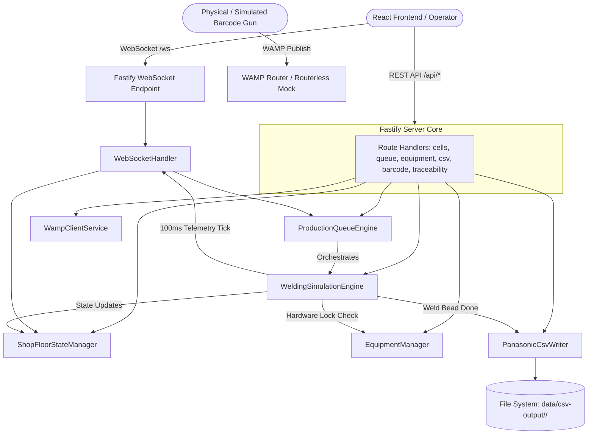
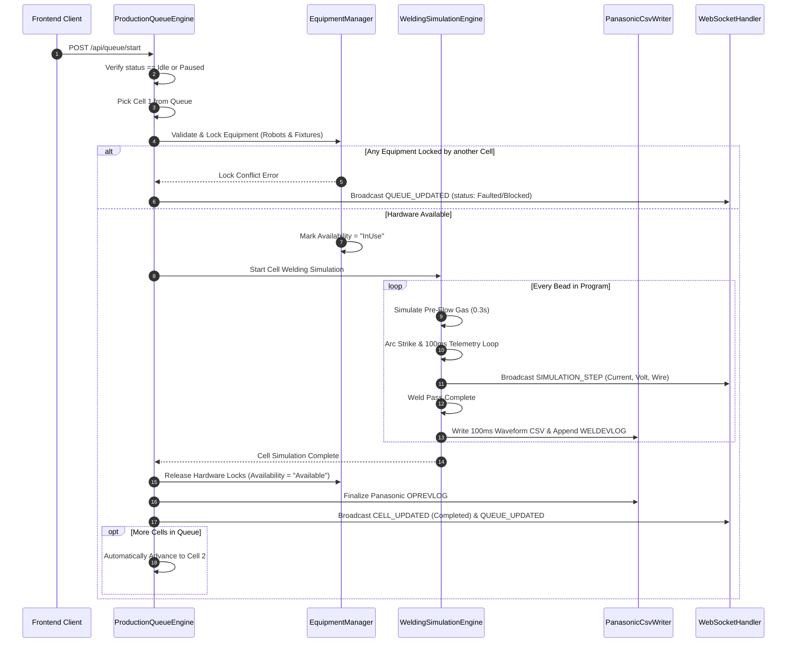

# Backend Architecture, Workflow & Low-Level Design (LLD)

Welding Shop-Floor Simulator - Server Engine

---

## 1. Overview & Technology Stack

| Layer | Technology | Purpose |
|---|---|---|
| **Runtime & Language** | Node.js (v18+) + TypeScript 5 | High-throughput asynchronous server |
| **HTTP Framework** | Fastify | Low-overhead REST API server (port 3001) |
| **WebSocket Engine** | `@fastify/websocket` + `ws` | Real-time event streaming (`/ws`) |
| **Industrial Messaging** | WAMP (WebSocket Application Messaging Protocol) | Barcode scan ingestion over `/barcode` topic |
| **File I/O Engine** | Node `fs` & `path` | Panasonic controller byte-exact CSV writing |
| **Watcher & Dev** | `tsx` | TypeScript execution without pre-compilation step |

---

## 2. High-Level Backend Architecture



---

## 3. Core Backend Workflows (Simple Explanation)

### Workflow 1: Sequential Queue Execution Loop


---

### Workflow 2: Hardware Reservation & Mutual Exclusion Locks
Kyunki shop floor par physical robots aur fixtures limited hote hain, do cells ek hi robot ko simultaneously use nahi kar sakte:
1. Jab cell start hota hai, `EquipmentManager.lockEquipment(cellId, [robotIds, fixtureIds])` call hota hai.
2. Agar koi hardware pehle se kisi running cell ke lock me hai, to execution instantly block ho jati hai aur safety event log hota hai.
3. Cell execution finish (ya stopped/faulted) hone par `EquipmentManager.releaseEquipment(cellId)` hardware availability ko `Available` set karta hai.

---

### Workflow 3: Panasonic Controller CSV Generation Handshake
Har cell run ke baad backend exact Panasonic byte format me files disk par save karta hai:
- Directory: `data/csv-output/<ControllerSerialNumber>/`
- Files generated:
  1. **`WELDEVLOG.csv`**: Daily append log containing cumulative arc times, wire consumption, and alarm codes.
  2. **`OPREVLOG.csv`**: Operator actions log (Program selection, E-STOP events, run start/stop).
  3. **`<JobWorkSN>_B<BeadNum>_WAVE.csv`**: Exact 8-line header with 100ms sampling telemetry data (Time, Current, Voltage, WireFeed).

---

## 4. Low-Level System Design (LLD)

### A. Core Services & Class Architecture

#### 1. `ShopFloorStateManager` (`services/state-manager.ts`)
- In-memory authoritative store for:
  - `Map<string, Cell>`
  - `ProductionHistoryRecord[]`
  - `EventLog[]`
- Handles cell CRUD operations and event stream recording.

#### 2. `EquipmentManager` (`services/equipment-manager.ts`)
- Manages equipment inventory:
  - `Map<string, EquipmentRegistryItem>`
  - `activeLocks: Map<string, string>` (EquipmentID -> CellID)
- Methods:
  - `registerEquipment(item)`
  - `validateAndLockEquipment(cellId, robotIds, fixtureIds)`
  - `releaseEquipment(cellId)`
  - `getAllEquipment()`

#### 3. `WeldingSimulationEngine` (`services/simulation-engine.ts`)
- Industrial physics and motion simulation loop:
  - Timer tick: `100ms`
  - Gaussian noise on Arc Current (`targetCurrent ± 5A`) and Arc Voltage (`targetVoltage ± 0.8V`).
  - State machine per bead: `Pending -> PreFlow -> ArcStrike -> Welding -> CraterFill -> PostFlow -> Completed`.
  - Methods:
    - `startManualCellWeld(cellId)`
    - `stopCellWeld(cellId)`
    - `injectFault(cellId, fixtureId, reason)`

#### 4. `ProductionQueueEngine` (`services/queue-engine.ts`)
- Sequential dispatcher state machine:
  - States: `Idle -> Running -> Paused -> Completed / Faulted`
  - Methods:
    - `startQueue()`
    - `pauseQueue()`
    - `resumeQueue()`
    - `stopQueue()`
    - `reorderQueue(orderedQueueItemIds)`
    - `retryCell(cellId)`

#### 5. `PanasonicCsvWriter` (`services/csv-writer.ts`)
- Ensures file structure compatibility with industrial Panasonic robot controllers:
  - Prepares directories under `data/csv-output/<controllerSN>/`.
  - Writes standard 8-line Panasonic header:
    ```csv
    PANASONIC ROBOT WELDING CONTROLLER WAVEFORM FILE
    CONTROLLER SERIAL: SN-CTRL-98421
    WORKPIECE SN: 1234567890
    BEAD NUMBER: 1
    SAMPLE INTERVAL: 100ms
    CH1: CURRENT(A), CH2: VOLTAGE(V), CH3: WIRE(m/min)
    [DATA START]
    TIME_MS,CURRENT,VOLTAGE,WIRE_FEED,GAS_FLOW
    ```
  - Appends to daily `WELDEVLOG.csv` and `OPREVLOG.csv`.

---

### B. Directory Structure

```text
backend/
├── package.json                 # Dependencies (Fastify, ws, tsx)
├── tsconfig.json                # TypeScript ESNext config
├── data/                        # Persistent output storage
│   ├── csv-output/              # Controller folders: <SN>/
│   └── storage/                 # State persistence backups
├── src/
│   ├── server.ts                # Fastify app initialization & listen
│   ├── config/
│   │   └── index.ts             # Port 3001, storage paths, WAMP config
│   ├── models/
│   │   └── types.ts             # Domain models (Cell, Robot, Fixture, Queue)
│   ├── services/
│   │   ├── state-manager.ts     # In-memory cell & event state
│   │   ├── equipment-manager.ts # Hardware registry & reservation locks
│   │   ├── simulation-engine.ts # 100ms weld simulation engine
│   │   ├── queue-engine.ts      # Multi-cell sequential executor
│   │   ├── csv-writer.ts        # Panasonic byte-accurate CSV generator
│   │   └── wamp-client.ts       # Industrial WAMP pub/sub handler
│   ├── websocket/
│   │   └── ws-handler.ts        # WebSocket connection & event broadcast
│   └── routes/
│       ├── cells.ts             # /api/cells (CRUD & manual start/stop)
│       ├── queue.ts             # /api/queue (start, pause, reorder, retry)
│       ├── equipment.ts         # /api/equipment (register, locks)
│       ├── csv.ts               # /api/csv (metadata list, file content preview)
│       ├── barcode.ts           # /api/barcode (scan publication)
│       └── traceability.ts      # /api/traceability (workpiece lookup)
```
