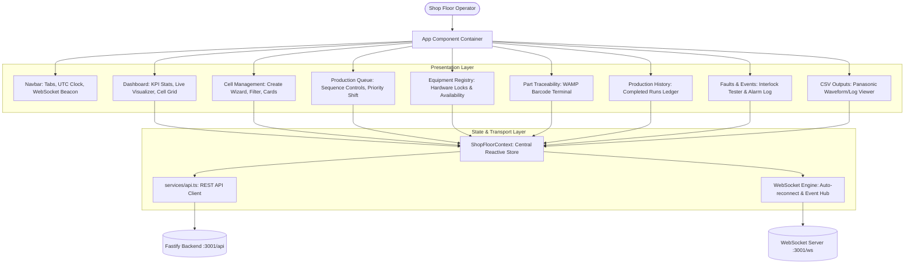
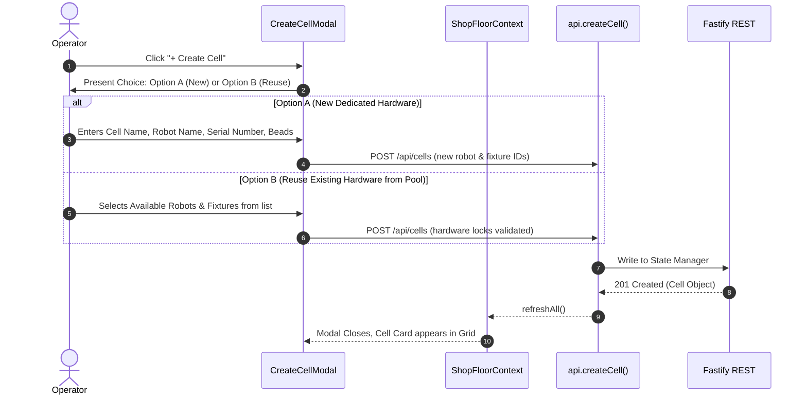

# Frontend Architecture, Workflow & Low-Level Design (LLD)

Welding Shop-Floor Simulator - Client Web Application

---

## 1. Overview & Technology Stack

| Layer | Technology | Purpose |
|---|---|---|
| **Core Framework** | React 18 + TypeScript | Component-driven UI with strict type safety |
| **Build & Dev Tool** | Vite 5 | Fast HMR, proxy management, and bundler |
| **Styling** | Vanilla CSS Design System | Custom cyberpunk/industrial SCADA dark theme |
| **Motion Simulation** | HTML5 Canvas 2D API | 60 FPS articulated robot kinematics & arc sparks |
| **Icons** | Lucide React | High-tech industrial UI iconography |
| **Real-Time Data** | Native Browser WebSockets | Sub-100ms bidirectional telemetry streaming |
| **HTTP Transport** | Fetch API | REST CRUD operations for cells, queue, equipment |

---

## 2. High-Level Frontend Architecture



---

## 3. Core Frontend Workflows (Simple Explanation)

### Workflow 1: Initial Page Load & Auto-Sync
1. Jab operator browser me `http://localhost:5173` open karta hai, `ShopFloorProvider` mount hota hai.
2. `ShopFloorContext` turant do parallel operations trigger karta hai:
   - **REST Initial Fetch (`refreshAll`)**: Cells, Queue, Equipment, Events, aur CSV metadata load karta hai.
   - **WebSocket Connection (`ws://localhost:3001/ws`)**: Agar dev mode hai to direct backend port 3001 se connect hota hai.
3. Jab WebSocket connect hota hai, Navbar me red `OFFLINE` badge green `LIVE` beacon me convert ho jata hai.
4. Backend instantly `SNAPSHOT` message bhejta hai jo context state ko refresh karta hai.

---

### Workflow 2: Cell Creation (Option A vs Option B)


---

### Workflow 3: Sequential Production Execution
1. Operator **Production Queue** tab me jaata hai.
2. Cells ko `↑` / `↓` buttons se reorder karta hai (Priority scheduling).
3. Operator **Start Queue** button click karta hai:
   - Request jaati hai: `POST /api/queue/start`.
   - Backend sequentially execute karta hai: Pehla cell run hota hai, har bead weld hoti hai, Panasonic CSV likhi jaati hai.
   - Live progress bar har cell card par update hoti hai.
   - Ek cell complete hone ke baad automatically agla cell start hota hai.
4. Agar kisi cell me error ya E-STOP aaye:
   - Queue automatically **Paused** ho jaati hai.
   - Operator ko **Retry Cell** button dikhta hai.

---

### Workflow 4: Barcode Scanning & Traceability
1. Operator **Traceability** tab me workpiece ka barcode scan ya type karta hai (e.g. `BC-CHASSIS-2026-9042`).
2. Target cell choose karke **Publish Scan via WAMP** click karta hai.
3. Frontend `POST /api/barcode/scan` call karta hai.
4. Backend is barcode ko WAMP topic `/barcode` par publish karta hai aur workpiece serial number ko assign karta hai.
5. Workpiece ke tamam welded beads aur corresponding Panasonic CSV log files screen par dikh jati hain.

---

## 4. Low-Level System Design (LLD)

### A. State Management Store (`ShopFloorContext.tsx`)

#### State Variables
| State Variable | Type | Description |
|---|---|---|
| `cells` | `Cell[]` | List of all configured shop-floor welding cells |
| `queue` | `ProductionQueue \| null` | Current sequential execution queue state |
| `equipment` | `EquipmentRegistryItem[]` | Pool of physical robots and tooling fixtures |
| `events` | `EventLog[]` | Alarm logs and system notifications |
| `csvFiles` | `CsvFileMetadata[]` | Generated Panasonic CSV files on disk |
| `isConnected` | `boolean` | Live WebSocket connection status |
| `selectedCellId` | `string` | Currently focused cell for live canvas visualizer |

#### WebSocket Event Dispatch Matrix
```typescript
switch (msg.type) {
  case 'SNAPSHOT':
    // Bulk state hydration on initial connect
    setCells(msg.payload.cells);
    setQueue(msg.payload.queue);
    setEquipment(msg.payload.equipment);
    break;

  case 'CELL_UPDATED':
    // Single cell state change (e.g. status, progress)
    updateCellInList(msg.payload);
    break;

  case 'SIMULATION_STEP':
    // Sub-100ms weld telemetry (current, voltage, bead progress)
    updateLiveTelemetry(msg.payload);
    break;

  case 'QUEUE_UPDATED':
    // Queue position shift, pause, resume, completion
    setQueue(msg.payload);
    break;
}
```

---

### B. Canvas 2D Motion Engine (`WeldVisualizer.tsx`)

The visualizer uses a 60 FPS `requestAnimationFrame` loop to animate the robotic articulated arm:
1. **Coordinate Geometry**:
   - Robot base fixed at `(220, 80)`.
   - Tooling table fixed at `(140, 220, width: 420, height: 35)`.
   - Workpiece clamped at table center.
2. **Kinematic Inverse Motion**:
   - Weld bead tip calculates `torchX = workpieceX + (workpieceWidth * progressPct)`.
   - Robot elbow joint dynamically interpolates midpoint `((baseX + torchX)/2 - 30, (baseY + torchY)/2 - 20)`.
3. **Arc Emission Physics**:
   - If `isWelding == true`:
     - Canvas draws high-intensity white electric core with radial blur (`shadowBlur = 25`, `shadowColor = #00e5ff`).
     - Emits 12 randomized sparks per frame with varying angle and radial distance (`angle = Math.random() * Math.PI - Math.PI`).

---

### C. Directory Structure

```text
frontend/
├── index.html                   # HTML entry point with fonts & meta
├── package.json                 # Dependencies (React, Lucide, Vite)
├── vite.config.ts               # Proxy configuration & port 5173
├── src/
│   ├── main.tsx                 # React DOM root render
│   ├── App.tsx                  # Top-level tab router & layout
│   ├── index.css                # Universal industrial design tokens & utilities
│   ├── types/
│   │   └── index.ts             # Mirror TypeScript interfaces from backend
│   ├── context/
│   │   └── ShopFloorContext.tsx # Central WebSocket/REST provider & hook
│   ├── services/
│   │   └── api.ts               # REST API fetch functions
│   ├── components/
│   │   ├── Navbar.tsx           # Global header, tabs & live clock
│   │   ├── CellCard.tsx         # Cell HUD card with control buttons
│   │   ├── WeldVisualizer.tsx   # Canvas 2D live motion visualizer
│   │   ├── QueueControlPanel.tsx# Sequential queue controller
│   │   ├── CreateCellModal.tsx  # Option A / Option B wizard modal
│   │   └── CsvModal.tsx         # Panasonic CSV inspector modal
│   └── pages/
│       ├── Dashboard.tsx        # KPI metrics & main monitor
│       ├── CellManagement.tsx   # Cell grid with search & filter
│       ├── ProductionQueue.tsx  # Queue execution dashboard
│       ├── EquipmentRegistry.tsx# Hardware items pool & reservation locks
│       ├── PartTraceability.tsx # Barcode terminal & part history
│       ├── ProductionHistory.tsx# Historical runs table
│       ├── FaultsEvents.tsx     # E-STOP fault injection & logs
│       └── CsvOutputs.tsx       # Panasonic CSV file manager
```
